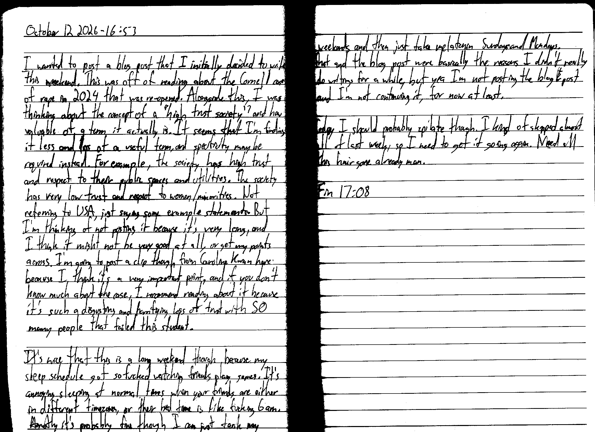

October 12 2026 - 16:53

I wanted to post a blog post that I initially decided to write this weekend. This was off of reading about the Cornell case of rape in 2024 that was re-opened. Alongside this, I was thinking about the concept of a "high trust society" and how valuable of a term it actually is. It seems that I'm finding it less and less of a useful term, and specificity may be required instead. For example, the society has high trust and respect to their public spaces and utilities. The society has very low trust and respect to women/minorities. Not referring to USA, just saying some example statements. But I'm thinking of not posting it because it's very long, and I think it might not be very good at all, or [not] get my points across. I'm going to post a clip though from [Caroline Kwan here](https://www.youtube.com/watch?v=KluL4nahLCw) because I think it's a very important point, and if you don't know much about the case, I recommend reading about it because it's such a disgusting and horrifying loss of trust with SO many people that failed this student.

<video controls preload="metadata" playsinline>
  <source src="/videos/caroline-clip-av1.mp4" type='video/mp4; codecs="av01.0.05M.08"' />
  <source src="/videos/caroline-clip-h264.mp4" type="video/mp4" />
  Your browser does not support the video tag.
</video>
```
I hope that we don't look at a situation where it's easier to call it out.

Most of us are not Cornell students.
This is not our community.
We're not in a frat.
We see these men and correctly identify them as abusers.
We correctly call for justice and accountability here
But then.
Continue to **fail** to do so when it is happening in our own communities.

Whether that is leftist spaces online, calling out misogyny and sexism and violence
Or it's even smaller than that
In our own friend groups
In our families
In all of these different communities we are in

Where
it becomes harder
because it's more personal
and because we feel we have more to lose
if we identify this, and call out how harmful it is, and call for an end to it.

---

The more adjacent you are to power
The higher you are up on the totem pole
The more that shield is given to you

So.

That is how, too, abusers stay so protected. Because, they also understand that
the more power they have
the more closely aligned to it that they are
it offers them more of an ability to
conduct harm
and not face accountability

These are situations that happen every single day.
Every single day.
In every community.
In every space.
```

It's nice that this is a long weekend though because my sleep schedule got so fucked watching friends play games. It's annoying sleeping at normal times when your friends are either in different timezones, or their bed time is like fucking 6 am. Honestly it's probably fine though I can just tank my weekends and then just take melatonin Sundays and Mondays. That and the blog post were basically the reasons I didn't really do writings for a while, but yea I'm not posting the blog ~~L~~ post and I'm not continuing it, for now at least.

Today I should probably epilate though. I kind of skipped about all of last week, so I need to get it going again. Need all this hair gone already man.

Fin 17:08