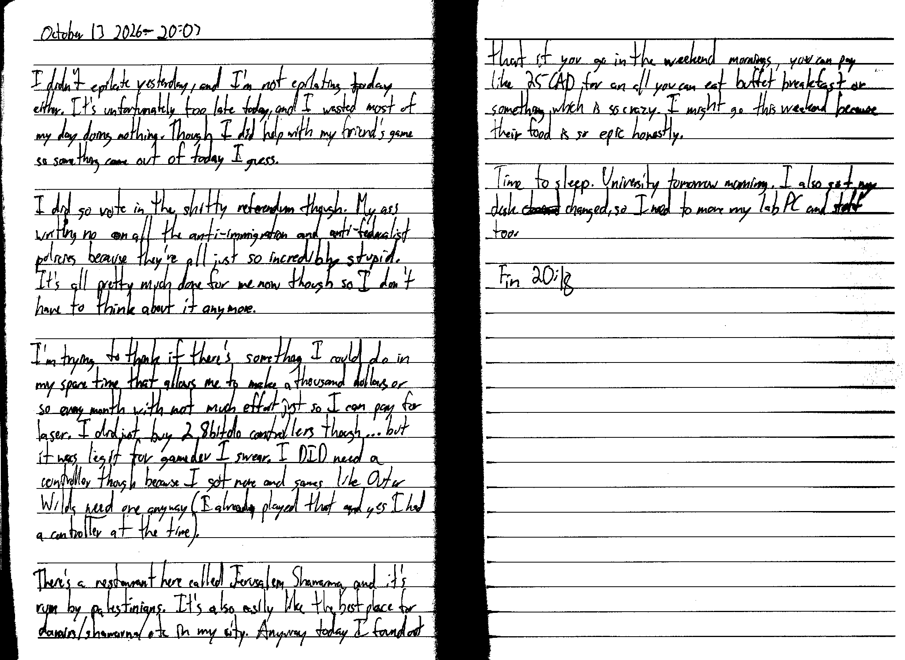

October 13 2026 - 20:03

I didn't epilate yesterday, and I'm not epilating today either. It's unfortunately too late today, and I wasted most of my day doing nothing. Though I did help with my friend's game so something came out of today I guess.

I did go vote in the shitty referendum though. My ass writing no on all the anti-immigration and anti-federalist policies because they're all just so incredibly stupid. It's all pretty much done for me now though so I don't have to think about it anymore.

I'm trying to think if there's something I could do in my spare time that allows me to make a thousand dollars or so every month with not much effort just so I can pay for laser. I did just buy 2 8bitdo controllers though... but it was legit for gamedev I swear. I DID need a controller though because I got none and games like Outer Wilds *need* one anyway (I already played that and yes I had a controller at the time).

There's a restaurant here called Jerusalem Shawarma, and it's run by palestinians. It's also easily the best place for donairs/shawarma/etc in my city. Anyway today I found out that if you go in the weekend mornings, you can pay like 25 CAD for an all you can eat buffet breakfast or something which is so crazy. I might go this weekend because their food is so epic honestly.

Time to sleep. University tomorrow morning. I also got my desk ~~chained~~ changed, so I need to move my lab PC and stuff too.

Fin 20:18