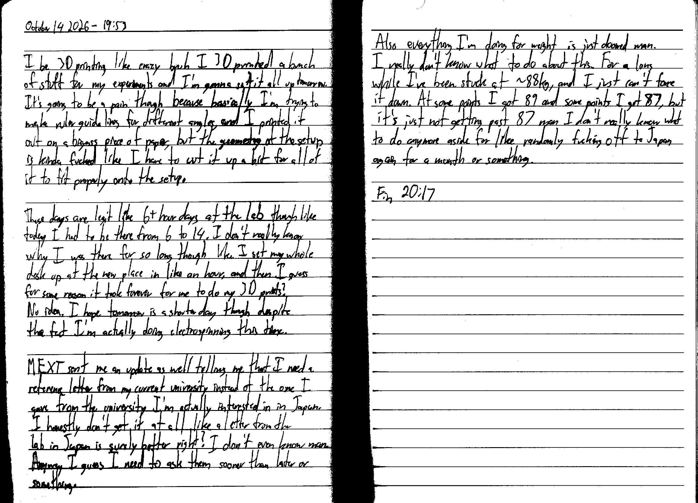

October 14 2026 - 19:53

I be 3D printing like crazy bruh I 3D printed a bunch of stuff for my experiments and I'm gonna set it all up tomorrow. It's going to be a pain though because basically I'm trying to make ruler guide lines for different angles, and I printed it out on a bigass piece of paper, but the geometry of the setup is kinda fucked like I have to cut it up a bit for all of it to fit properly onto the setup.

These days are legit like 6+ hour days at the lab though like today I had to be there from 6 to 14. I don't really know why I was there for so long though like I set my whole desk up at the new place in like an hour, and then I guess for some reason it took forever for me to do my 3D prints? No idea. I hope tomorrow is a shorter day though despite the fact I'm actually doing electrospinning this time.

MEXT sent me an update as well telling me that I need a reference letter from my current university instead of the one I gave from the university I'm actually interested in in Japan. I honestly don't get it at all like a letter from the lab in Japan is surely better right? I don't even know man. Anyway I guess I need to ask them sooner than later or something.

Also everything I'm doing for weight is just doomed man. I really don't know what to do about this. For a long while I've been stuck at ~88 kg, and I just can't force it down. At some points I got 89 and some points I get 87, but it's just not getting past 87 man I don't really know what to do anymore aside for like randomly fucking off to Japan again for a month or something.

Fin 20:17