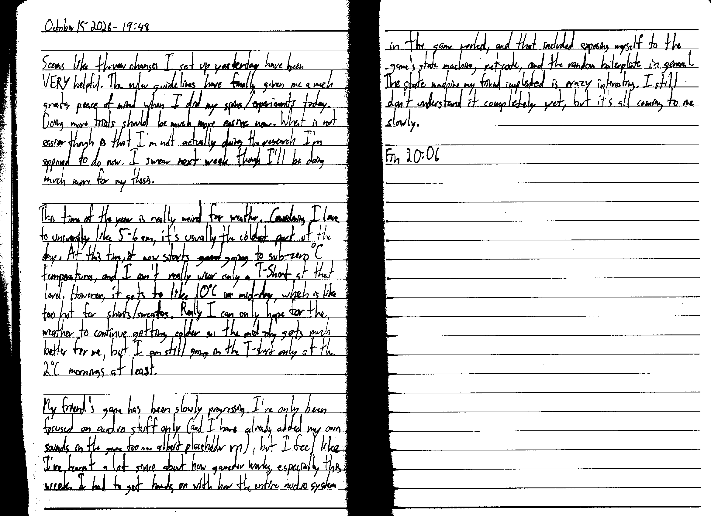

October 15 2026 - 19:48

Seems like the new changes I set up yesterday have been VERY helpful. The ruler guide lines have finally given me a much greater peace of mind when I did my spins/experiments today. Doing more trials should be much more easier now. What is not easier though is that I'm not actually doing the research I'm supposed to do now. I swear next week though I'll be doing much more for my thesis.

This time of the year is really weird for weather. Considering I leave to university like 5-6 am, it's usually the coldest part of the day. At this time, it now starts ~~goind~~ going to sub-zero $^{\circ} C$ temperatures, and I can't really wear only a T-Shirt at that level. However, it gets to like $10^{\circ} C$ in mid-day, which is like too hot for shirts/sweaters. Really I can only hope for the weather to continue getting colder so the mid-day gets much better for me, but I am still going in the T-shirt only at the $2^{\circ} C$ mornings at least.

My friend's game has been slowly progressing. I've only been focused on audio stuff only (and I have already added my own sounds in the game too... albeit placeholder rn), but I feel like I've learnt a lot since about how gamedev works, especially this week. I had to get hands on with how the entire audio system in the game worked, and that included exposing myself to the game's state machine, netcode, and the random boilerplate in general. The state machine my friend implemented is crazy interesting. I still don't understand it completely yet, but it's all coming to me slowly.

Fin 20:06