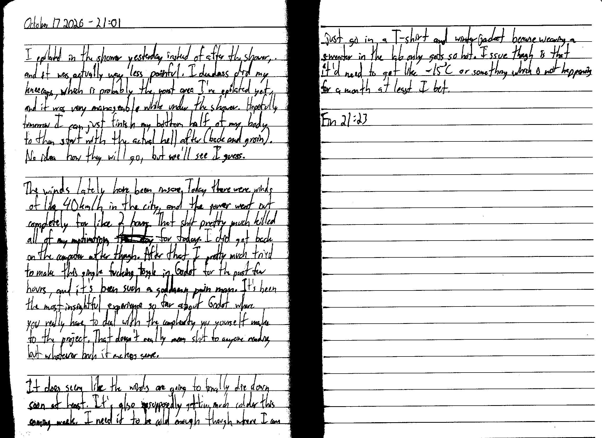

October 17 2026 - 21:01

I epilated in the shower yesterday instead of after the shower, and it was actually way less painful. I deadass did my kneecaps, which is probably the worst area I've epilated yet, and it was very manageable while under the shower. Hopefully tomorrow I can just finish my bottom half of my body to then start with the actual hell after (back and groin). No idea how they will go, but we'll see I guess.

The winds lately have been insane. Today there were winds of like 40 km/h in the city, and the power went out completely for like 2 hours. That shit pretty much killed all of my motivation ~~that day~~ for today. I did get back on the computer after though. After that I pretty much tried to make this single fucking toggle in Godot for the past few hours, and it's been such a goddamn pain man. It's been the most insightful experience so far about Godot where you really have to deal with the complexity you yourself make to the project. That doesn't really mean shit to anyone reading but whatever bruh it makes sense.

It does seem like the winds are going to finally die down soon at least. It's also ~~sp~~ supposedly getting much colder this coming week. I need it to be cold enough though where I can just go in a T-shirt and winter jacket because wearing a sweater in the lab [~~only~~] gets so hot. Issue though is that it'd need to get like $-15^{\circ} C$ or something which is not happening for a month at least I bet.

Fin 21:23