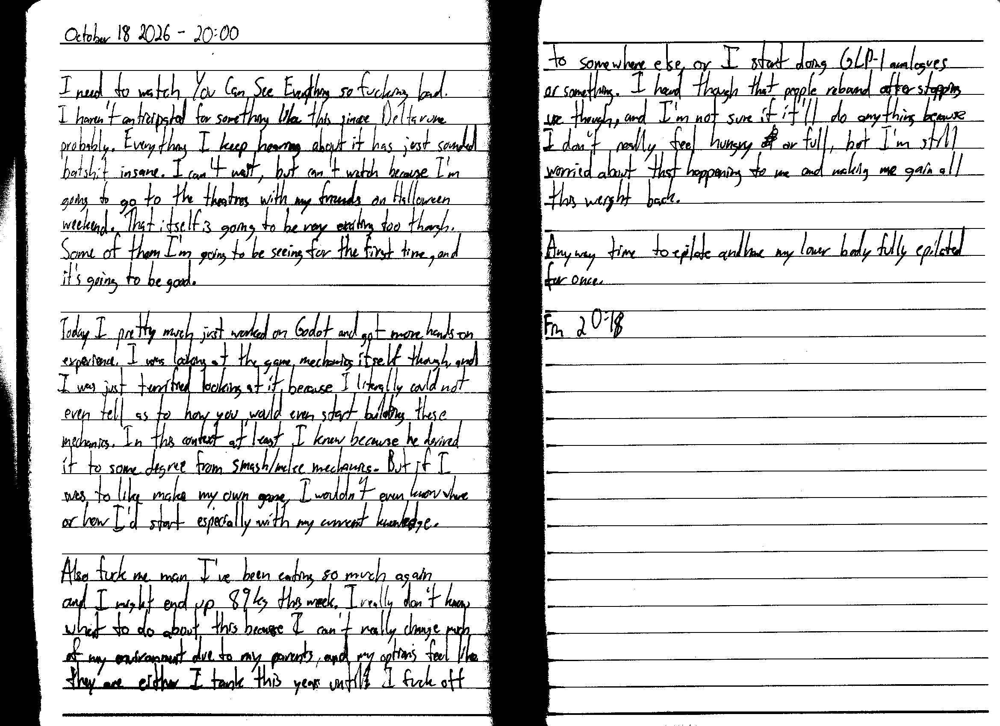

October 18 2026 - 20:00

I need to watch You Can See Everything so fucking bad. I haven't anticipated for something like this since Deltarune probably. Everything I keep hearing about it has just sounded batshit insane. I can't wait, but can't watch because I'm going to the theatres with my friends on Halloween weekend. That itself is going to be very exciting too though. Some of them I'm going to be seeing for the first time, and it's going to be good.

Today I pretty much just worked on Godot and got more hands-on experience. I was looking at the game mechanics itself though, and I was just terrified looking at it because I literally could not even tell as to how you would even start building these mechanics. In this context at least I knew because he derived it to some degree from smash/melee mechanics. But, if I was to like make my own game, I wouldn't even know where or how I'd start, especially with my current knowledge.

Also fuck me man I've been eating so much again and I might end up 89 kg this week. I really don't know what to do about this because I can't really change much of my environment due to my parents, and my options feel like they are either I tank this year until~~l~~ I fuck off to somewhere else, or I start doing GLP-1 analogues or something. I heard though that people rebound after stopping use though, and I'm not sure if it'll do anything because I don't really feel hungry ~~of~~ or full, but I'm still worried about that happening to me and making me gain all this weight back.

Anyway time to epilate and have my lower body fully epilated for once.

Fin 20:18