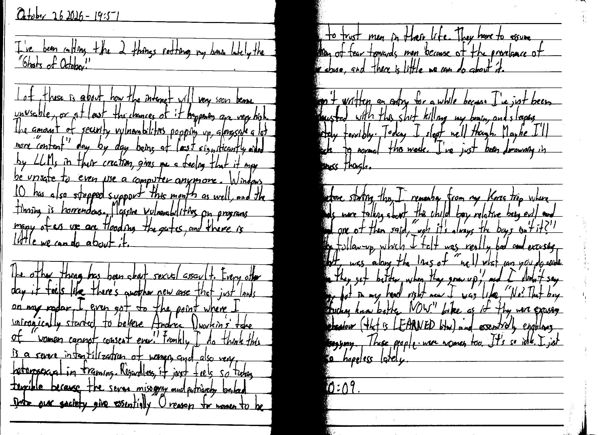

October 26 2026 - 19:51

I've been calling the 2 things rotting my brain lately the "Ghosts of October".

1 of these is about how the internet will very soon become unusable, or at least the chances of it happening are very high. The amount of security vulnerabilities popping up, alongside a lot more "content" day by day being at least significantly aided by LLMs in their creation, gives me a feeling that it may be unsafe to even use a computer anymore. Windows 10 has also stopped support this month as well, and the timing is horrendous. Massive vulnerabilities on programs many of us use are flooding the gates, and there is little we can do about it.

The other thing has been about sexual assault. Every other day it feels like there's another new one that just lands on my radar. I even got to the point where I unironically started to believe Andrea Dworkin's take of "women cannot consent ever". Frankly I do think this is a severe infantilization of women, and also very heterosexual in framing. Regardless, it just feels so fucking terrible because the severe misogyny and patriarchy baked into our system give essentially 0 reason for women to be able to trust men in their life. They have to assume a position of fear towards men because of the prevalence of gender abuse, and there is little we can do about it.

I haven't written an entry for a while because I've just been so exhausted with this shit killing my brain, and sleeping absolutely terribly. Today I slept well though. Maybe I'll be back to normal this week. I've just been drowning in hopelessness though.

Just before starting this [entry], I [remembered] from my Korea trip where my friends were talking about this child boy relative being evil and shit, and one of them said "ugh it's always the boys isn't it?" and the follow-up, which I felt was really bad and excusing the shit, was along the lines of "well what can you do aside to hope they get better when they grow up," and I didn't say anything [at the time], but in my head right now I was like "No? That boy should fucking know better NOW." Like as if they were excusing the behaviour (that is LEARNED btw) and essentially enabling the misogyny. These people were women too. It's so idk. I just feel so hopeless lately.

Fin 20:09