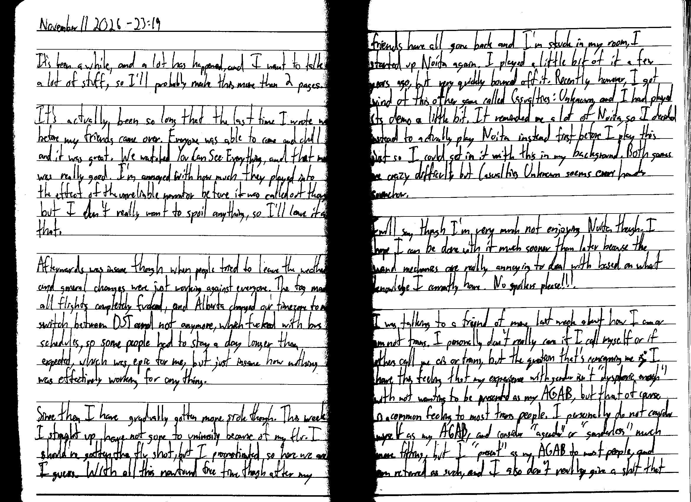
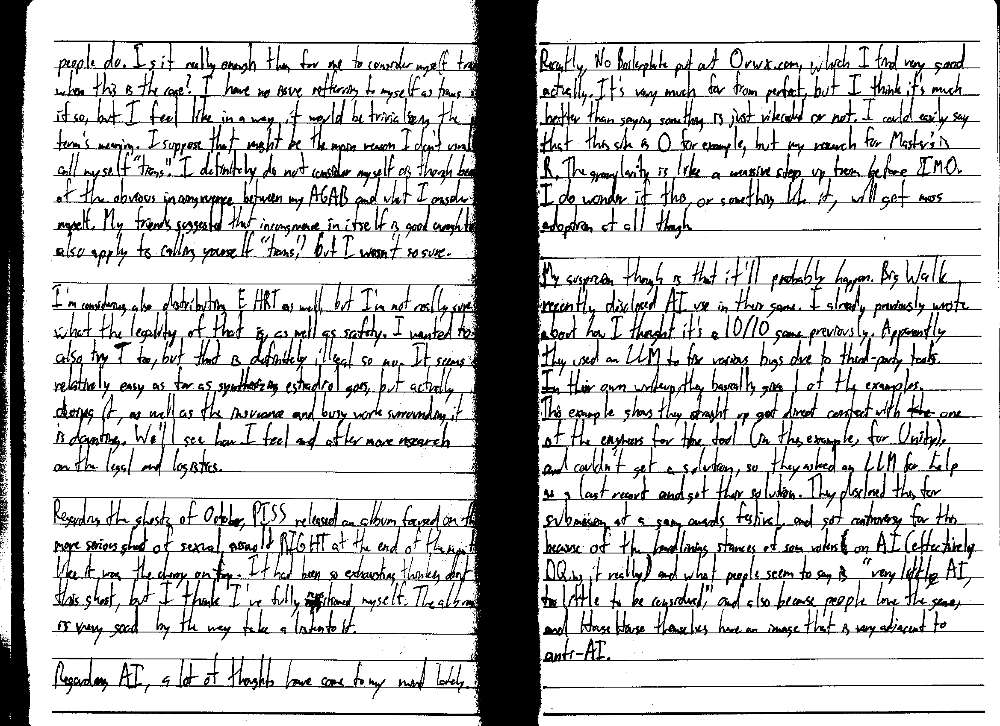
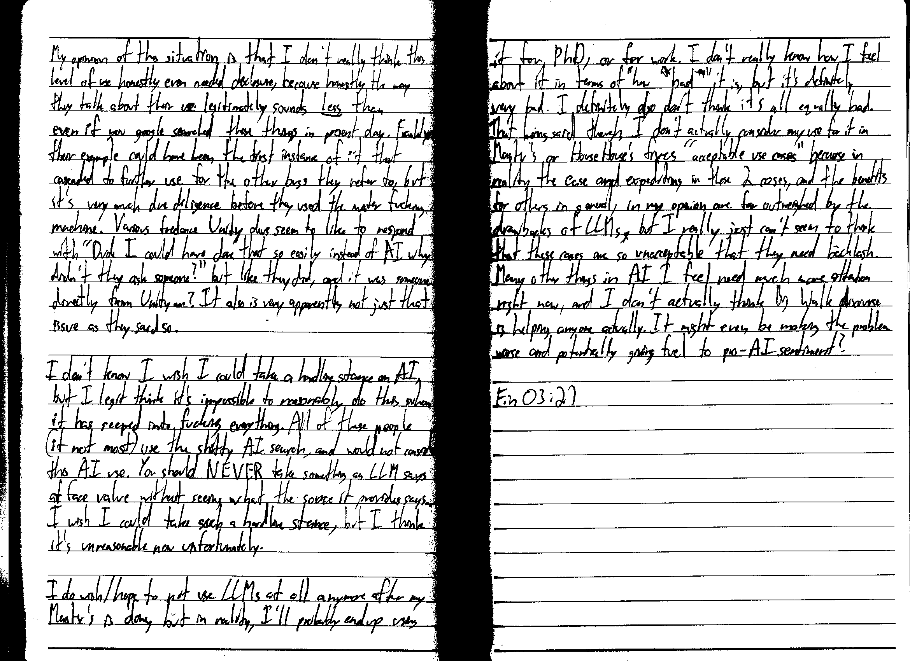

  

November 11 2026 - 23:19

It's been a while, and a lot has happened, and I want to talk a lot of stuff, so I'll probably make this more than 2 pages.

It's actually been so long that the last time I wrote was before my friends came over. Everyone was able to come and chill and it was great. We watched You Can See Everything, and that movie was really good. I'm annoyed with how much they played into the effect of the unreliable narrator before it was called out though, but I don't really want to spoil anything, so I'll leave it at that.

Afterwards was insane though when people tried to leave the weather and general changes were just working against everyone. The fog made all flights completely fucked, and Alberta changed out timezone to not switch between DST and not anymore, which fucked with bus schedules, so some people had to stay a day longer than expected, which was epic for me, but just insane how nothing was effectively working for anything.

Since then I have gradually gotten more sick though. This week I straight up have not gone to university because of my flu. I should've gotten the flu shot, but I procrastinated so here we are I guess. With all this newfound free time though after my friends have all gone back and I'm stuck in my room, I started up Noita again. I played a little bit of it a few years ago, but very quickly bounced off it. Recently however I got wind of this other game called Casualties: Unknown, and I had played its demo a little bit. It reminded me a lot of Noita, so I decided instead to actually play Noita instead first before I play this just so I could get in it with this in my background. Both games are crazy difficult but Casualties Unknown seems even harder somehow.

I will say though I'm very much not enjoying Noita though. I hope I can be done with it much sooner than later because the wand mechanics are really annoying to deal with based on what knowledge I currently have. No spoilers please!!!

I was talking to a friend of mine last week about how I am or am not trans. I personally don't really care if I call myself or if others call me cis or trans, but the question that's concerning me is: I have this feeling that my experience with gender isn't "dysphoric enough" with not wanting to be presented as my AGAB, but that of course is a common feeling to most trans people. I personally do not consider myself as my AGAB, and consider "agender" or "genderless" much more fitting, but I "present" as my AGAB to most people, and am referred as such, and I also don't really give a shit that people do. Is it really enough then for me to consider myself trans when this is the case? I have no issue [referring] to myself trans if so, but I feel like in a way it would be trivializing the term's meaning. I suppose that might be the main reason I don't usually call myself "trans." I definitely do not consider myself as "cis" though because of the obvious incongruence between my AGAB and what I consider myself. My friend suggested that incongruence in itself is good enough to also apply to calling yourself "trans," but I wasn't so sure.

I'm considering also distributing E HRT as well, but I'm not really sure what the legality of that is, as well as safety. I wanted to also try T too, but that is definitely illegal so no. It seems relatively easy as far as synthesizing estradiol goes, but actually doing it, as well as the insurance and busy work surrounding it is daunting. We'll see how I feel and after more research on the legal and logistics.

Regarding the ghosts of October, PISS [released an album](https://pisstheband.bandcamp.com/album/you-made-me-skin-on-linen) focused on the more serious ghost of sexual assault RIGHT at the end of the month like it was the cherry on top. It had been so exhausting thinking about this ghost, but I think I've fully repositioned myself. The album is very good by the way take a listen to it.

Regarding AI,  a lot of thoughts have come to my mind lately. Recently, No Boilerplate put out [0rwx.com](https://0rwx.com/), which I find very good actually. It's very much far from perfect, but I think it's much better than saying something is vibecoded or not. I could easily say that this site is 0 for example, but my research for Master's is R. The granularity is like a massive step up from before IMO. I do wonder if this, or something like it, will get mass adoption at all though.

My suspicion though is that it'll probably happen. Big Walk recently disclosed AI use in their game. I already previously wrote about how I thought it's a 10/10 game previously. Apparently they used an LLM to fix various bugs due to third-party tools. [In their own writeup](https://bigwalk.game/faq/ai/), they basically gave 1 of the examples. This example shows they straight up god direct contact with ~~the~~ one of the engineers for the tool (in this example, for Unity), and couldn't get a solution, so they asked an LLM for help as a last resort and got their solution. They disclosed this for submission at a game awards festival, and got controversy for this because of the hardlining stances of some voters on AI (effectively DQing it really) and what people seem to say is "very little AI, too little to be considered," and also because people love the game, and House House themselves have an image that is very adjacent to anti-AI.

My opinion of this situation is that I don't really think this level of use honestly even needed disclosure, because honestly the way they talk about their use legitimately sounds **less** than even if you google searched these things in present day. Frankly, their example could have been the first instance of it that cascaded to further use for the other bugs they refer to, but it's very much due diligence before they used the water fucking machine. Various freelance Unity devs seem to like to respond with "Dude I could have done that so easily instead of AI why didn't they ask someone?" but like they did, and it was someone directly from Unity...? It also is very apparently not just that issue as they said so.

I don't know I wish I could take a hardline stance on AI, but I legit think it's impossoble to reasonably do this when it has seeped into fucking everything. All of these people (if not most) use the shitty AI search, and would not consider this AI use. You should NEVER take something as LLM says at face value without seeing what the source it provides says. I wish I could take such a hardline stance, but I think it's unreasonable now unfortunately.

I do wish/hope to not use LLMs at all anymore after my Master's is done, but in reality, I'll probably end up using it for PhD, or for work. I don't really know how I feel about it in terms of how "bad" it is, but it's definitely very bad. I definitely also don't think it's all equally bad. That being said though, I don't actually consider my use for it in Master's or House House's fixes "acceptable use cases" because in reality the ease and expediting in these 2 cases and the benefits for others in general, in my opinion, are far outweighed by the drawbacks of LLMs, but I really just can't seem to think that these cases are so unacceptable that they need backlash. Many other things in AI I feel need much more attention right now, and I don't actually think Big Walk discourse is helping anyone actually. It might even be making the problem worse and potentially giving fuel to pro-AI sentiment?

Fin 03:21